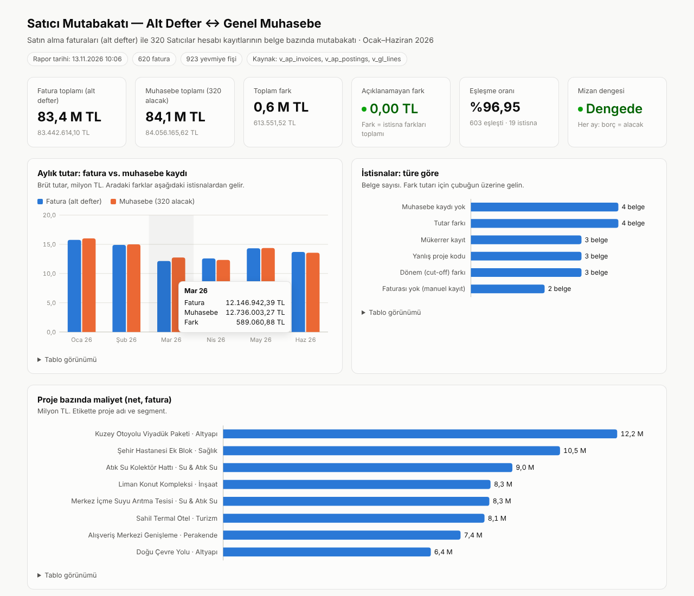

# Satıcı Mutabakatı & Raporlama Otomasyonu
**Accounts Payable Reconciliation & BI Reporting Pipeline — SQL · Python (pandas) · Excel · HTML/JS Dashboard**

Bir inşaat ve altyapı grubunun satın alma faturalarını (alt defter) genel muhasebedeki
**320 Satıcılar** kayıtlarıyla belge bazında karşılaştıran, farkları kaynağına kadar izleyen
ve sonuçları yönetim için Excel raporu ile interaktif dashboard'a döken uçtan uca bir
iş zekâsı projesi.



**Canlı dashboard:** `docs/index.html` (GitHub Pages ile yayınlanır) · **Excel raporu:** `docs/mutabakat_raporu.xlsx`

---

## Problem
Rapor toplamı kaynak sistemle birebir tutmuyorsa rapor yanlıştır. Mizanın dengede olması
da tek başına yeterli değildir. Bir fatura hiç kaydedilmemiş, iki kez kaydedilmiş ya da
yanlış projeye yazılmış olsa bile **borç = alacak** dengesi bozulmaz. Bu proje, bu tür
hataları belge düzeyinde yakalayıp toplam farkın **tamamını** açıklamayı hedefler.

## Ne yapıyor?
| Adım | Açıklama | Dosya |
|---|---|---|
| 1. Veri çekme | Rapor view'ları üzerinden SQL ile (`SELECT`, `JOIN`, `GROUP BY`) | `sql/01_views.sql` |
| 2. Mizan kontrolü | Her dönemde toplam borç = toplam alacak | `src/reconcile.py` |
| 3. Mutabakat | Her fatura 320'de doğru tutar, proje ve dönemle **tam bir kez** kaydedilmiş mi? | `src/reconcile.py` |
| 4. Kontrol kapısı | Açıklanamayan fark ≠ 0 ya da mizan dengesizse **rapor üretilmez** | `run_pipeline.py` |
| 5. Raporlama | Excel raporu (mizan, muavin, istisnalar, XLOOKUP, formüllü çapraz kontrol) + HTML/JS dashboard | `src/build_report.py` |
| 6. KVKK | VKN ve IBAN maskelenir, gereksiz kişisel alanlar çıktıya hiç taşınmaz | `src/privacy.py` |
| 7. Doğrulama | 7 otomatik test, sonuçları bağımsız SQL ve cevap anahtarıyla karşılaştırır | `tests/` |

## Yakalanan istisna türleri
| Tür | Örnek | Önerilen aksiyon |
|---|---|---|
| Muhasebe kaydı yok | Fatura var, yevmiye kaydı yok | Faturayı muhasebeleştir |
| Faturası yok | Dayanaksız manuel kayıt | Dayanağı sor; yoksa ters kayıt |
| Mükerrer kayıt | Aynı fatura iki fişle kaydedilmiş | Mükerrer fişi iptal et |
| Tutar farkı | Veri girişinde rakamların yer değiştirmesi (18.261 → 81.261) | Fişi düzelt |
| Yanlış proje kodu | Maliyet başka projeye yazılmış | Virman |
| Dönem (cut-off) farkı | Ay sonu faturası sonraki aya kaydedilmiş | Dönem düzeltmesi / tahakkuk |

**Sonuç (örnek veri):** 620 fatura, 923 yevmiye fişi. %96,95 eşleşme ve 19 istisna.
Toplam farkın tamamı istisnalarla açıklanıyor, **açıklanamayan fark 0,00 TL**.

## Çalıştırma
```bash
pip install -r requirements.txt
python run_pipeline.py --regenerate   # veri üret → mutabakat → kontrol kapısı → rapor
python -m pytest -q                   # 7 doğrulama testi
```
Çıktılar `docs/` klasörüne yazılır, çalışma günlüğü `output/run_log.txt` dosyasına düşer.

## Doğrulama yaklaşımı
- **Cevap anahtarı:** Veri üreticisi bilinçli olarak 19 hata ekler ve bunları `known_errors.csv` dosyasına yazar. Testler motorun bu hataların **hepsini ve yalnızca bunları** doğru türle bulduğunu kontrol eder.
- **Bağımsız SQL:** Python'daki toplamlar, ham tablolara doğrudan yazılan ayrı SQL sorgularıyla karşılaştırılır.
- **Excel içinde çapraz kontrol:** Özet sayfası, Python'un hesapladığı farkı Excel formülleriyle (`SUM`, `COUNTIF`, `IF`) yeniden hesaplar.
- **Kontrol kapısı:** Tutmayan bir rapor yönetime gitmez, işlem hata koduyla biter.

## Oracle notu
Proje taşınabilirlik için SQLite kullanır. View'lar standart SQL'dir. Oracle'da tek fark tarih
biçimlendirmesidir: `strftime('%Y-%m', d)` yerine `TO_CHAR(d, 'YYYY-MM')` kullanılır.
Bağlantı satırını `oracledb.connect(...)` ile değiştirmek yeterlidir.

## Yapay zekâ kullanımı
Bu proje, Claude Code ile yapay zekâ destekli olarak geliştirildi. Üretilen kod satır satır
incelendi. Tüm sonuçlar yukarıdaki testler, bağımsız SQL sorguları ve Excel çapraz kontrolüyle
kaynak veriye karşı doğrulandı.

## Veri
Tüm veriler sentetiktir. Tedarikçi adları, vergi numaraları ve IBAN'lar rastgele üretilmiştir ve gerçek kişi veya kurumlarla ilgisi yoktur.

---
**Melisa Çavdar** · melisacavdar53@gmail.com
